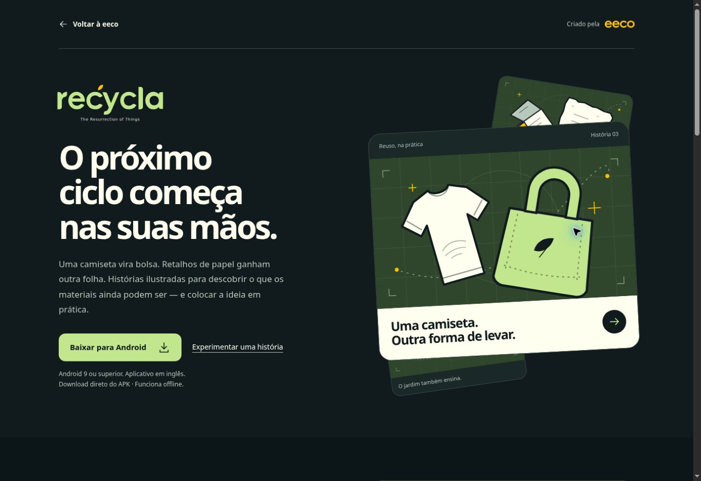

# eeco

**Empowering evolutionary ecosystems.** A creative agency and movement founded by Hapi.

A responsive, self-contained website in English, Brazilian Portuguese and Egyptian Arabic. Its story connects the agency’s strategy, brand and digital work with Carmen, Alquimia and Kemet.

## Project structure

- `source/template.html` — semantic markup with readable English fallback.
- `source/style.css` — brand palette, shared control styles, responsive layouts, RTL and reduced-motion support.
- `source/copy.json` — all three languages, metadata and accessibility labels.
- `source/main.js` — language switching, scroll-triggered reveals, active-section navigation and keyboard-accessible service tabs.
- `source/assets/` — supplied brand assets and locally embedded fonts, including font licenses.
- `build.py` — dependency-free Python builder.
- `dist/index.html` — portable build with embedded assets, fonts and font licenses.

## Build and preview

Run `python3 build.py`, then serve `dist/` with any static web server. The page requires no runtime dependencies, third-party scripts, external font requests or backend.

The GitHub repository also has the identical generated page at `index.html` for hosts that serve from the repository root. The deployment output is `dist/`.

## Brand and content

Solar yellow `#FCBF01`, dark green-black `#111B1E`, plum `#26161F`, navy `#0D203B`, deep blue `#01111D` and alabaster `#FFFFF0` follow the supplied eeco identity. Quicksand is used for Latin text and Noto Sans Arabic for Arabic.

Original logos are preserved. Carmen and eeco use supplied transparent assets. Alquimia and Kemet use CSS multiply blending to eliminate the white background in the rendered page without redrawing or recoloring the source artwork. The light project surfaces are deliberate and required for this blending treatment.

Carmen is described as developing organic, nature-inspired health and personal-care products for a healthier lifestyle in the city, according to the founder’s brief. Regeneration is presented as a purpose and ambition. No product certifications, medical benefits, client results or measured environmental impact are claimed.

## Validation

The redesign was reviewed in the browser in all three languages within 320, 390, 768 and 1280px frames, without horizontal document overflow. The mobile interface uses a centered app bar, a native language selector, a fixed four-section navigation dock and compact service tabs. Section numbers and the GitHub footer link have been removed from all languages. On-scroll entrances use the Web Animations API and IntersectionObserver once per element; content remains readable without animation support. Reduced-motion preferences are respected, including changes while the page is open. Desktop project-logo rendering was visually reviewed. The builder checks translation coverage and unresolved assets; anchor targets and JavaScript syntax were also checked.

The site preserves its existing private audience. GitHub is a source copy; this repository does not claim automatic deployment integration.

## Interface refinement — November 2026

The latest pass adds a curved brand stage, a short pointer-triggered emblem gesture, geometric icons in the mobile dock, related-element reveal staggering, a scroll-linked process line, complete Kemet logo containment, and immediate keyboard service switches. See DESIGN.md for the preserved visual system and selected design references. Source and both generated HTML outputs stay in sync.

## Recycla showcase

[Open Recycla in Sites](https://eeco-by-hapi.hapi-alquimias.chatgpt.site/recycla/) · [Open eeco](https://eeco-by-hapi.hapi-alquimias.chatgpt.site)

The Alquimia ecosystem card has been restored to its previous design and destination. The Recycla showcase remains available at `/recycla/` and through the footer link. The new page uses the original logo, palette, system typography and native story illustrations from Recycla-App, source revision `5b80b9b662d7963679ccea4fc28e6cc6c3fba203`. Portuguese previews faithfully adapt three bundled stories; the Android application itself is in English. The signed 0.4.0 APK includes seven stories and works offline. Its bundled story catalog was compared with the referenced repository.

`recycla/page.css` and `recycla/page.js` provide the responsive page and keyboard-accessible story previews. `recycla/art/` contains exported original SVG covers and diagrams. The dependency-free build copies the whole Recycla directory into `dist/recycla/`. The eeco project card supports the existing English, Portuguese and Arabic language choices.

